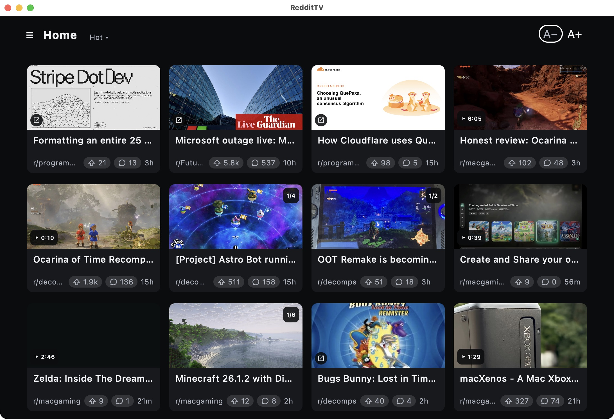
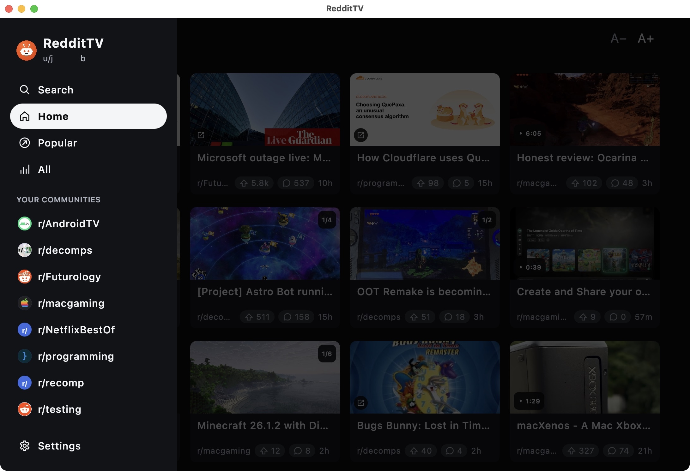
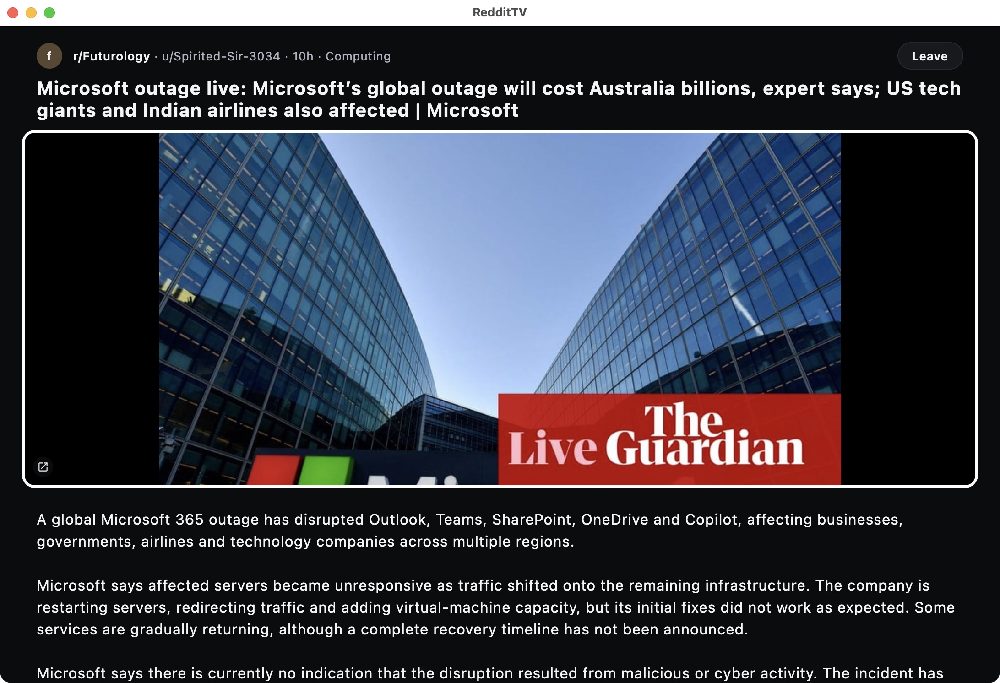
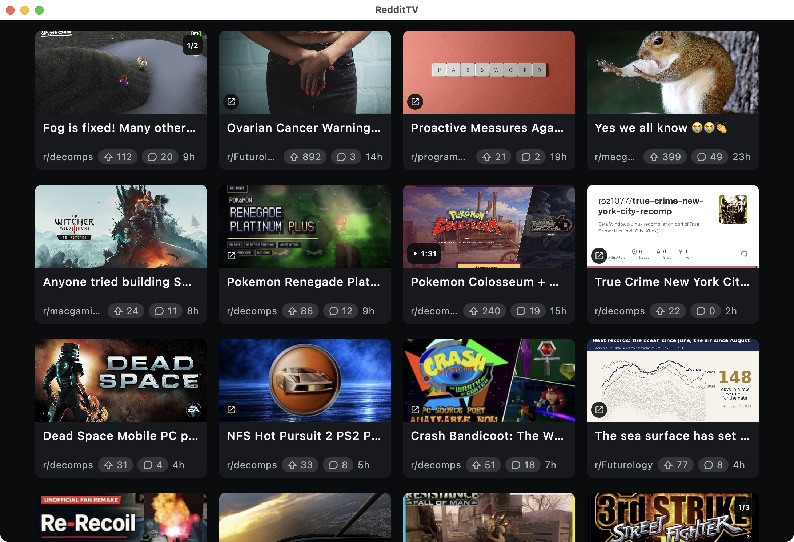
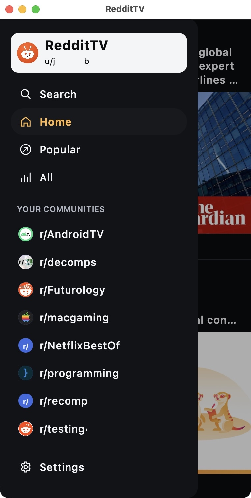
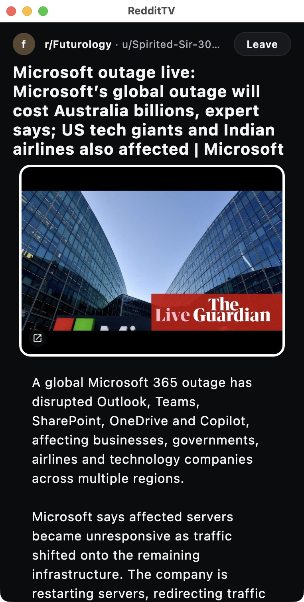

<div align="center">


# RedditTV

**Browse Reddit from the couch**

<!-- shields.io has no Fire TV or Windows logo: they carry their own (a TV / four panes, base64 SVG in
     the logo= param), same as Share to TV+ -->
[](#install-tv)
[](#install-tv)
[](#install-android)
[](#install-desktop)
[](#install-desktop)
[](#install-desktop)

<br>



</div>

---

## What is it?

RedditTV is a **big, simple Reddit viewer made for your TV remote**. Your home feed shows up as a
 grid of posts you can read from across the room

It runs on Android TV, Google TV and Fire TV, and the same app works on your phone (as a simple
scrolling list) and on your Mac, Windows or Linux computer.

## Why you might like it

Reddit doesn't have a TV app, and its website on a TV browser is miserable with a remote: tiny
text, a mouse pointer you have to steer around, and videos that don't play.

---

## Screenshots

### TV



<br>



### Phone





---

## Features

- **Made for the remote**: a 2/3/4-column grid sized to read from across the room. Press LEFT for the
  menu with your communities
- **Videos play right in the grid**: no clicking through to watch
- **Galleries**: step through every picture with LEFT/RIGHT, straight from the grid
- **Posts open full screen**: the picture or video first, then the text and comments in one scroll
- **Your communities**: Home, Popular, All, and every community you've joined, one press away.
  Search for new ones, join or leave them
- **Sort** by Hot, New, Top or Rising
- **Bigger or smaller text** (A– / A+) for posts and comments
- **Sign in with your phone**: scan the QR code on the TV and type your password on your phone, not
  with the remote. Or browse without signing in
- **No API key, no account to set up, nothing in between**: you sign in on Reddit's own login page
  and the app reads Reddit just like your browser does
- **Free, no ads**

---

<a id="install-section"></a>

## Install

RedditTV is **free** on GitHub. It's one app for phones, tablets and TVs, and it checks for updates
itself: you'll be told in the app when there's a new version.

<a name="install-tv"></a>
<h3>Fire TV / Google TV / Android TV</h3>

1. Install the **Downloader** app on the TV (search for it in the TV's app store)
2. Fire TV only: let Downloader install apps in **Settings ▸ My Fire TV ▸ Developer Options**
3. In Downloader, enter this address to download and install:

```
https://github.com/jpage4500/reddit-tv/releases/download/android/RedditTV.apk
```

<a name="install-android"></a>
<h3>Android phone / tablet</h3>

- Download [**RedditTV.apk**](https://github.com/jpage4500/reddit-tv/releases/download/android/RedditTV.apk)
  on the phone and open it. Android asks once to allow installs from your browser

<a name="install-desktop"></a>
<h3>Desktop (Mac / Windows / Linux)</h3>

- [GitHub release page](https://github.com/jpage4500/reddit-tv/releases): pick the installer for your
  computer. The desktop app updates itself when a new version comes out

<h3>iPhone / iPad</h3>

Not available yet.

---

## About Me

I've been a developer for 20+ years. I am passionate about the products I work on and work to make them
the best in class any way that I can. AI has undoubtedly changed the programming landscape forever, and
I'm embracing it head-on. I know what I want in an app and AI allows me to get there 1000 times faster
than doing it myself. While that also means anyone can create an app from scratch today, I know what
features should look like, how to provide excellent support, and how to keep the code from getting
unmanageable. I will NEVER release any AI SLOP. Software can work differently for different people so
maintaining it is critical for making it last.

---

## Support

Found a bug or want something added? Send feedback from the app (**About ▸ Support / Feedback**) or
[open an issue](https://github.com/jpage4500/reddit-tv/issues).

I try to be very responsive to support or bug requests. If it's something that's feasible and makes
sense to add, I'll do it.

---

## For developers

Kotlin Multiplatform + Compose Multiplatform (Android, iOS, desktop). See [CLAUDE.md](CLAUDE.md)
for build commands and [docs/How It Works.md](docs/How%20It%20Works.md) for the sign-in and data
approach.

---

<sub>Unofficial. Not affiliated with, endorsed by, or sponsored by Reddit, Inc. "Reddit" is a
trademark of Reddit, Inc.</sub>
